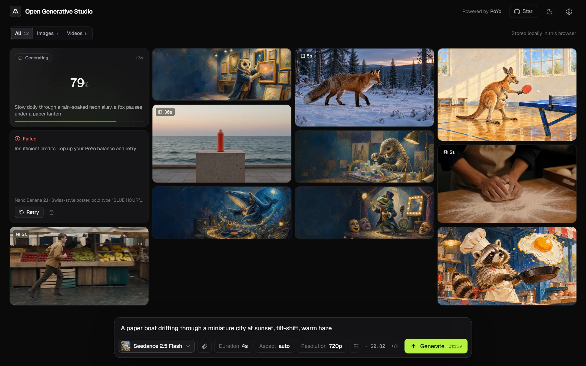
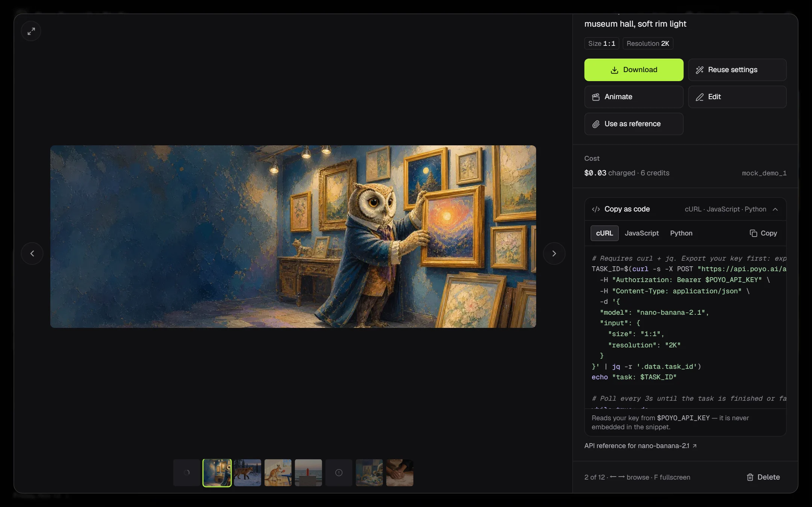
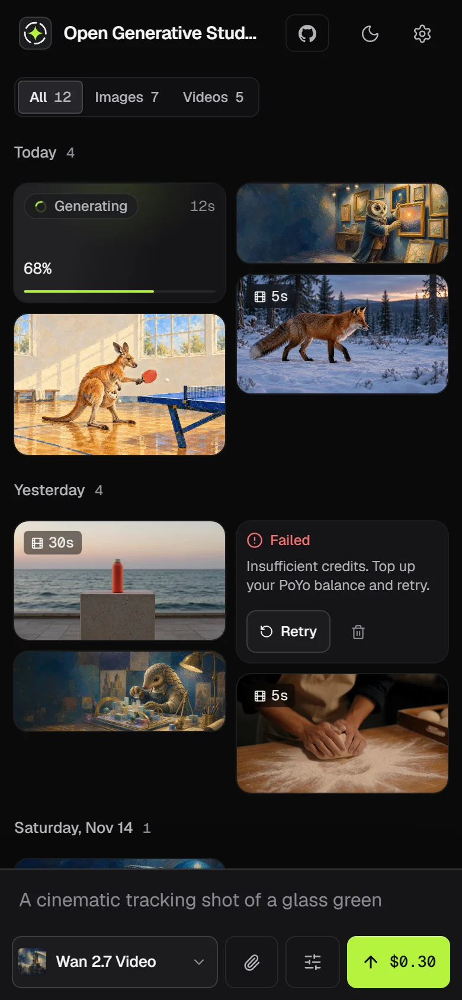
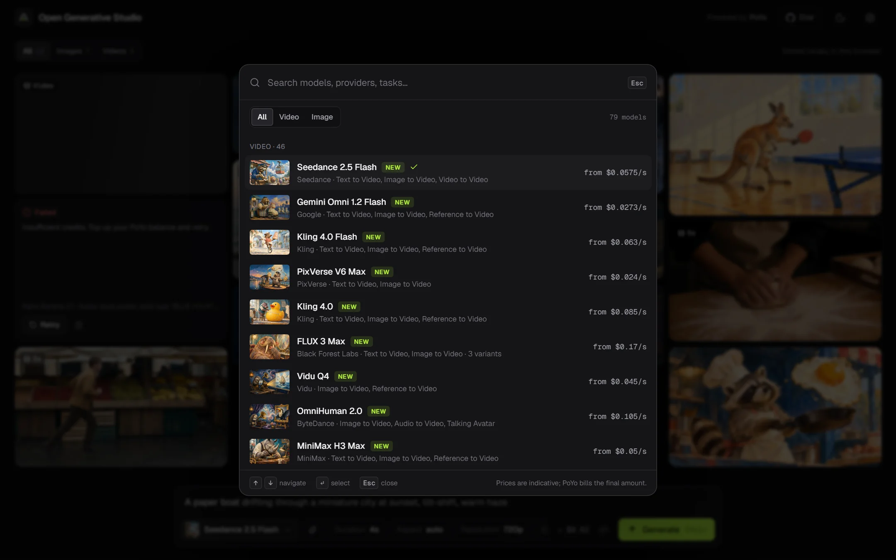
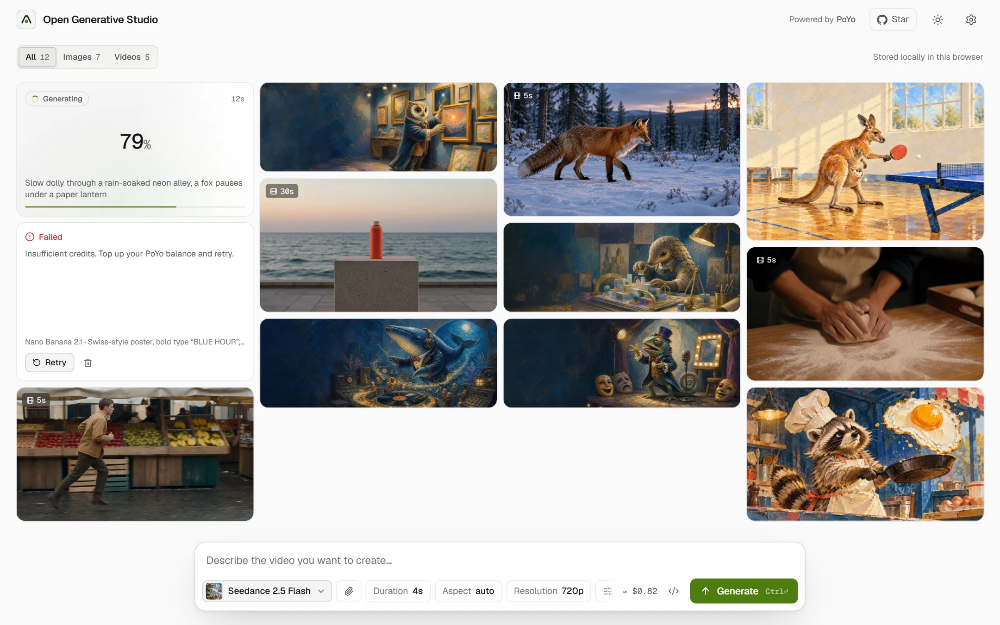

<div align="center">


# Open Generative Studio

**Open-source AI image & video studio — <!-- models-count -->79<!-- /models-count --> models (Seedance 2.5, Kling 4.0, Veo, GPT Image 2.6, Nano Banana…) with your own API key.**

Self-hostable · white-label · runs entirely in the browser · MIT

[**Quick start**](#quick-start) · [**Deploy**](#deploy-in-1-click) · [**Models**](#supported-models) · [**White-label**](#white-label--resell) · [**FAQ**](#faq)

[](LICENSE)
[](https://github.com/coolhackboy/open-generative-studio/stargazers)




</div>

## Why

Most AI studios are closed SaaS with their own credits and markup. **Open Generative Studio** is a polished,
keyboard-first studio you can run anywhere: clone it, paste a [PoYo](https://poyo.ai/?utm_source=github&utm_medium=readme&utm_campaign=open-generative-studio)
API key, and generate images and videos from dozens of top models. Requests go straight from your browser to the
API — no backend to deploy, no database, nothing to maintain. Fork it to build your own AI product.

## Features

- **One studio, many models** — video and image models from ByteDance, Kling, Google, OpenAI, Black Forest Labs,
  MiniMax, Alibaba, xAI and more, all through one API key.
- **Gallery-first UI** — your works are the hero: masonry gallery, live progress cards, failed cards with retry,
  image / video filters, dark and light themes.
- **Schema-driven composer** — parameter chips are generated from each model's input schema (aspect ratio,
  duration, resolution, count…), with client-side validation and a **live cost estimate** before you generate.
- **Reference media** — drag & drop, paste or pick images, videos and audio; they are uploaded and routed to the
  right input (first frame, reference images, reference video…).
- **Model palette** — <kbd>⌘</kbd>/<kbd>Ctrl</kbd> + <kbd>K</kbd> to search every model with its starting price.
- **Copy as code** — every generation exports the exact submit + poll request as **cURL, JavaScript or Python**.
- **Keyboard-first** — <kbd>⌘</kbd>/<kbd>Ctrl</kbd> + <kbd>Enter</kbd> generate · <kbd>⌘</kbd>/<kbd>Ctrl</kbd> + <kbd>K</kbd>
  models · <kbd>/</kbd> focus prompt · <kbd>←</kbd> <kbd>→</kbd> browse · <kbd>Esc</kbd> close.
- **Private by default** — your key stays in `localStorage`; your gallery lives in IndexedDB on your device.
- **Resumable** — unfinished tasks keep polling after a page reload.
- **White-label** — brand name, logo, accent color and API base via environment variables.
- **Responsive** — down to 390 px wide, with a docked composer on mobile.

<table>
  <tr>
    <td width="62%"></td>
    <td width="38%"></td>
  </tr>
  <tr>
    <td></td>
    <td></td>
  </tr>
</table>

<sub>Screenshots use the built-in mock mode with sample media from PoYo model showcases.</sub>

## Quick start

Requires Node.js 20+.

```bash
git clone https://github.com/coolhackboy/open-generative-studio.git
cd open-generative-studio
npm install
npm run dev
```

Open <http://localhost:5173>, click **Add API key**, paste your key, and press <kbd>⌘</kbd>/<kbd>Ctrl</kbd> + <kbd>Enter</kbd>.

No key yet? Open <http://localhost:5173/?mock=1&seed=1> to explore the UI with simulated generations (dev server only).

To build a static site:

```bash
npm run build      # outputs dist/ — host it on any static file server
npm run preview    # preview the production build locally
```

## Get an API key

1. Sign in at **[poyo.ai/dashboard/api-key](https://poyo.ai/dashboard/api-key?utm_source=github&utm_medium=readme&utm_campaign=open-generative-studio)** and create a key.
2. Paste it in the studio under **Settings → API key**.

Every generation is billed to the PoYo account that owns the key, at PoYo's pay-as-you-go prices. The studio shows an
estimate before you generate and the actual credits charged afterwards.

## Deploy in 1 click

The app is a static site — no server, no database.

[](https://vercel.com/new/clone?repository-url=https%3A%2F%2Fgithub.com%2Fcoolhackboy%2Fopen-generative-studio&project-name=open-generative-studio&repository-name=open-generative-studio)
[](https://app.netlify.com/start/deploy?repository=https://github.com/coolhackboy/open-generative-studio)

Any static host works (Cloudflare Pages, GitHub Pages, S3, Nginx): build command `npm run build`, output directory `dist`.
Visitors of your deployment bring their own API key — it is never part of the build.

## White-label & resell

Rebrand the studio with environment variables at build time (copy [`.env.example`](.env.example) to `.env.local`,
or set them in your hosting dashboard):

| Variable | Default | Purpose |
| --- | --- | --- |
| `VITE_BRAND_NAME` | `Open Generative Studio` | Name in the top bar, page title and Open Graph tags |
| `VITE_BRAND_LOGO_URL` | built-in mark | Square logo (SVG/PNG URL) |
| `VITE_ACCENT` | PoYo lime | Accent color — any CSS color; hover and contrast colors are derived |
| `VITE_API_BASE` | `https://api.poyo.ai` | API endpoint the browser talks to |
| `VITE_SHOW_POWERED_BY` | `true` | Show the small "Powered by PoYo" link |

**How billing works.** Generations are billed to whichever key the browser sends. Out of the box each visitor uses
their own PoYo key, so hosting a public copy costs you nothing.

**Reselling with your own margin.** Don't put your PoYo key in a `VITE_*` variable — anything in the build is
visible to every visitor. Instead, run a small gateway that implements the same three endpoints
(`POST /api/generate/submit`, `GET /api/generate/status/{task_id}`, `POST /api/common/upload/stream`), authenticates
*your* users with keys you issue, forwards requests to PoYo with *your* PoYo key, and charges your users whatever
price you set. Point `VITE_API_BASE` at that gateway. Every generation then bills your PoYo account, and your
margin is the difference.

Deeper changes are easy too: design tokens live in [`src/styles/tokens.css`](src/styles/tokens.css), generic UI
primitives in [`src/ui/`](src/ui), and all backend-specific code in [`src/lib/api.ts`](src/lib/api.ts) and
[`src/config.ts`](src/config.ts).

## Copy as code

Found settings you like? Open any generation and copy the exact request as cURL, JavaScript or Python. The snippet
reads your key from `$POYO_API_KEY`, so it is safe to share:

```js
const API = "https://api.poyo.ai";
const headers = { Authorization: `Bearer ${process.env.POYO_API_KEY}`, "Content-Type": "application/json" };

const submit = await fetch(`${API}/api/generate/submit`, {
  method: "POST",
  headers,
  body: JSON.stringify({
    model: "seedance-2.5-flash",
    input: { prompt: "A paper boat drifting through a miniature city at sunset", duration: 5, resolution: "720p" },
  }),
}).then((r) => r.json());
const taskId = submit.data.task_id;

let task;
do {
  await new Promise((r) => setTimeout(r, 3000));
  task = (await fetch(`${API}/api/generate/status/${taskId}`, { headers }).then((r) => r.json())).data;
} while (task.status !== "finished" && task.status !== "failed");
console.log(task.files);
```

The composer's `</>` button does the same for the settings you haven't generated yet.

## Supported models

<!-- models:start -->
<!-- Generated by scripts/readme-models.mjs — do not edit by hand. -->

**79 models** — 46 video, 33 image · catalog snapshot 2026-11-17. Prices are the cheapest
public tier on PoYo at snapshot time; the app shows a live estimate for your exact settings and PoYo bills the final amount.

<details open>
<summary><b>Video models (46)</b></summary>

| Model | Provider | Variants | Price |
| --- | --- | --- | --- |
| [Seedance 2.5 Flash](https://poyo.ai/models/seedance-2-5-flash?utm_source=github&utm_medium=readme&utm_campaign=open-generative-studio) | Seedance | — | from $0.0575/s |
| [Gemini Omni 1.2 Flash](https://poyo.ai/models/gemini-omni-1-2-flash?utm_source=github&utm_medium=readme&utm_campaign=open-generative-studio) | Google | — | from $0.0273/s |
| [Kling 4.0 Flash](https://poyo.ai/models/kling-4-0-flash?utm_source=github&utm_medium=readme&utm_campaign=open-generative-studio) | Kling | — | from $0.063/s |
| [PixVerse V6 Max](https://poyo.ai/models/pixverse-v6-max?utm_source=github&utm_medium=readme&utm_campaign=open-generative-studio) | PixVerse | — | from $0.024/s |
| [Kling 4.0](https://poyo.ai/models/kling-4-0?utm_source=github&utm_medium=readme&utm_campaign=open-generative-studio) | Kling | — | from $0.085/s |
| [FLUX 3 Max](https://poyo.ai/models/flux-3-max?utm_source=github&utm_medium=readme&utm_campaign=open-generative-studio) | Black Forest Labs | Text to Video, Image to Video, Keyframes to Video | from $0.17/s |
| [Vidu Q4](https://poyo.ai/models/vidu-q4?utm_source=github&utm_medium=readme&utm_campaign=open-generative-studio) | Vidu | — | from $0.045/s |
| [OmniHuman 2.0](https://poyo.ai/models/omnihuman-2-0?utm_source=github&utm_medium=readme&utm_campaign=open-generative-studio) | ByteDance | — | from $0.105/s |
| [MiniMax H3 Max](https://poyo.ai/models/minimax-h3-max?utm_source=github&utm_medium=readme&utm_campaign=open-generative-studio) | MiniMax | — | from $0.05/s |
| [MiniMax H3 Max Turbo](https://poyo.ai/models/minimax-h3-max-turbo?utm_source=github&utm_medium=readme&utm_campaign=open-generative-studio) | MiniMax | — | from $0.025/s |
| [Gemini Omni 1.1 Flash](https://poyo.ai/models/gemini-omni-1-1-flash?utm_source=github&utm_medium=readme&utm_campaign=open-generative-studio) | Google | — | from $0.225/run |
| [Wan 3.0](https://poyo.ai/models/wan-3-0?utm_source=github&utm_medium=readme&utm_campaign=open-generative-studio) | Alibaba | Text to Video, Image to Video, Reference to Video | from $0.05/s |
| [Wan 3.0 Video Prime](https://poyo.ai/models/wan-3-0-video-prime?utm_source=github&utm_medium=readme&utm_campaign=open-generative-studio) | Alibaba | Text to Video, Image to Video, Reference to Video | from $0.068/s |
| [MiniMax H3 / Hailuo 03](https://poyo.ai/models/minimax-h3?utm_source=github&utm_medium=readme&utm_campaign=open-generative-studio) | MiniMax | — | from $0.105/s |
| [FLUX 3](https://poyo.ai/models/flux-3?utm_source=github&utm_medium=readme&utm_campaign=open-generative-studio) | Black Forest Labs | Text to Video, Image to Video, First & Last Frame, Extend Video, Keyframes to Video | from $0.17/s |
| [Seedance 2.5](https://poyo.ai/models/seedance-2-5?utm_source=github&utm_medium=readme&utm_campaign=open-generative-studio) | Seedance | — | from $0.085/s |
| [Seedance 2.0 Mini](https://poyo.ai/models/seedance-2-mini?utm_source=github&utm_medium=readme&utm_campaign=open-generative-studio) | Seedance | — | from $0.03/s |
| [Kling 3.0 Turbo](https://poyo.ai/models/kling-3-0-turbo?utm_source=github&utm_medium=readme&utm_campaign=open-generative-studio) | Kling | Standard, Pro | from $0.085/s |
| [Omni Flash](https://poyo.ai/models/omni-flash?utm_source=github&utm_medium=readme&utm_campaign=open-generative-studio) | Google | — | from $0.60/run |
| [Grok Imagine Video 1.5](https://poyo.ai/models/grok-imagine-video-1-5?utm_source=github&utm_medium=readme&utm_campaign=open-generative-studio) | xAI | — | from $0.0725/s |
| [Kling Avatar 2.0](https://poyo.ai/models/kling-avatar-2-0?utm_source=github&utm_medium=readme&utm_campaign=open-generative-studio) | Kling | Standard, Pro | from $0.035/s |
| [Happy Horse 1.1](https://poyo.ai/models/happy-horse-1-1?utm_source=github&utm_medium=readme&utm_campaign=open-generative-studio) | Alibaba | — | from $0.11/s |
| [Happy Horse](https://poyo.ai/models/happy-horse?utm_source=github&utm_medium=readme&utm_campaign=open-generative-studio) | Alibaba | — | from $0.08/s |
| [Seedance 2](https://poyo.ai/models/seedance-2?utm_source=github&utm_medium=readme&utm_campaign=open-generative-studio) | Seedance | Standard, Fast | from $0.045/s |
| [Wan 2.7 Video](https://poyo.ai/models/wan-2-7-video?utm_source=github&utm_medium=readme&utm_campaign=open-generative-studio) | Alibaba | Text to Video, Image to Video, Reference to Video, Edit Video | from $0.06/s |
| [Sora 2 Official](https://poyo.ai/models/sora-2-official?utm_source=github&utm_medium=readme&utm_campaign=open-generative-studio) | OpenAI | Official, Pro Official, Beta | from $0.20/video |
| [Kling 3.0 Motion Control](https://poyo.ai/models/kling-3-0-motion-control?utm_source=github&utm_medium=readme&utm_campaign=open-generative-studio) | Kling | — | from $0.045/s |
| [Hailuo 2.3](https://poyo.ai/models/hailuo-2-3?utm_source=github&utm_medium=readme&utm_campaign=open-generative-studio) | MiniMax | — | from $0.175/video |
| [Kling 1.6](https://poyo.ai/models/kling-1-6?utm_source=github&utm_medium=readme&utm_campaign=open-generative-studio) | Kling | Standard, Pro | from $0.045/s |
| [Kling 2.1](https://poyo.ai/models/kling-2-1?utm_source=github&utm_medium=readme&utm_campaign=open-generative-studio) | Kling | Standard, Pro | from $0.15/video |
| [Kling 2.5 Turbo Pro](https://poyo.ai/models/kling-2-5-turbo-pro?utm_source=github&utm_medium=readme&utm_campaign=open-generative-studio) | Kling | — | from $0.21/video |
| [Wan 2.2 Fast](https://poyo.ai/models/wan-2-2-fast?utm_source=github&utm_medium=readme&utm_campaign=open-generative-studio) | Alibaba | Image to Video, Text to Video | from $0.03/run |
| [Wan 2.5](https://poyo.ai/models/wan-2-5?utm_source=github&utm_medium=readme&utm_campaign=open-generative-studio) | Alibaba | Image to Video, Text to Video | from $0.15/video |
| [Runway Gen-4.5](https://poyo.ai/models/runway-gen-4-5?utm_source=github&utm_medium=readme&utm_campaign=open-generative-studio) | Runway | — | from $0.375/video |
| [Kling 3.0](https://poyo.ai/models/kling-3-api?utm_source=github&utm_medium=readme&utm_campaign=open-generative-studio) | Kling | Standard, Pro, 4K | from $0.135/s |
| [Kling O3](https://poyo.ai/models/kling-o3-api?utm_source=github&utm_medium=readme&utm_campaign=open-generative-studio) | Kling | Standard, Pro, 4K | from $0.05/s |
| [Kling 2.6 Motion Control](https://poyo.ai/models/kling-2-6-motion-control?utm_source=github&utm_medium=readme&utm_campaign=open-generative-studio) | Kling | — | from $0.04/s |
| [Seedance 1.5 Pro](https://poyo.ai/models/seedance-1-5-pro?utm_source=github&utm_medium=readme&utm_campaign=open-generative-studio) | Seedance | — | from $0.045/video |
| [Wan 2.6](https://poyo.ai/models/wan-2-6?utm_source=github&utm_medium=readme&utm_campaign=open-generative-studio) | Alibaba | Text to Video, Image to Video, Video to Video | from $0.40/video |
| [Grok Imagine](https://poyo.ai/models/grok-imagine?utm_source=github&utm_medium=readme&utm_campaign=open-generative-studio) | xAI | Image, Standard | from $0.03/image |
| [Hailuo 02](https://poyo.ai/models/hailuo-02?utm_source=github&utm_medium=readme&utm_campaign=open-generative-studio) | MiniMax | Standard, Pro | from $0.035/s |
| [Seedance 1.0 Pro](https://poyo.ai/models/seedance-1-pro?utm_source=github&utm_medium=readme&utm_campaign=open-generative-studio) | Seedance | — | from $0.105/video |
| [Kling 2.6](https://poyo.ai/models/kling-2-6?utm_source=github&utm_medium=readme&utm_campaign=open-generative-studio) | Kling | — | from $0.325/video |
| [Wan Animate](https://poyo.ai/models/wan-animate?utm_source=github&utm_medium=readme&utm_campaign=open-generative-studio) | Alibaba | Move, Replace | from $0.035/s |
| [Veo 3.1](https://poyo.ai/models/veo-3-1?utm_source=github&utm_medium=readme&utm_campaign=open-generative-studio) | Google | Lite, Fast, Quality | from $0.10/video |
| [Veo 3.1 Official](https://poyo.ai/models/veo-3-1-official?utm_source=github&utm_medium=readme&utm_campaign=open-generative-studio) | Google | Fast, Lite, Quality | from $0.018/s |

</details>

<details>
<summary><b>Image models (33)</b></summary>

| Model | Provider | Variants | Price |
| --- | --- | --- | --- |
| [Seedream 5.5](https://poyo.ai/models/seedream-5-5?utm_source=github&utm_medium=readme&utm_campaign=open-generative-studio) | Seedream | Standard, Layerize | from $0.02/image |
| [MiniMax H3 Image](https://poyo.ai/models/minimax-h3-image?utm_source=github&utm_medium=readme&utm_campaign=open-generative-studio) | MiniMax | — | from $0.016/image |
| [MAI Image 2.6](https://poyo.ai/models/mai-image-2-6?utm_source=github&utm_medium=readme&utm_campaign=open-generative-studio) | Microsoft | Standard, Flash | billed by usage |
| [GPT Image 2.6](https://poyo.ai/models/gpt-image-2-6?utm_source=github&utm_medium=readme&utm_campaign=open-generative-studio) | OpenAI | Flare, Sunburst, Fixed | from $0.0085/image |
| [Ideogram Vector 1.0](https://poyo.ai/models/ideogram-vector-1-0?utm_source=github&utm_medium=readme&utm_campaign=open-generative-studio) | Ideogram | Text to Vector, Image to Vector | from $0.10/image |
| [FLUX 3 Image Klein](https://poyo.ai/models/flux-3-klein?utm_source=github&utm_medium=readme&utm_campaign=open-generative-studio) | Black Forest Labs | Standard, Edit | from $0.009/image |
| [Nano Banana 2.1](https://poyo.ai/models/nano-banana-2-1?utm_source=github&utm_medium=readme&utm_campaign=open-generative-studio) | Google | — | from $0.02/image |
| [Seedream 5.0 Flash](https://poyo.ai/models/seedream-5-0-flash?utm_source=github&utm_medium=readme&utm_campaign=open-generative-studio) | Seedream | Standard, Edit | from $0.02/image |
| [Ideogram 4.5](https://poyo.ai/models/ideogram-4-5?utm_source=github&utm_medium=readme&utm_campaign=open-generative-studio) | Ideogram | Standard, Edit | from $0.008/image |
| [Qwen Image 2.1](https://poyo.ai/models/qwen-image-2-1?utm_source=github&utm_medium=readme&utm_campaign=open-generative-studio) | Alibaba | — | from $0.03/run |
| [GPT Image 2.5](https://poyo.ai/models/gpt-image-2-5?utm_source=github&utm_medium=readme&utm_campaign=open-generative-studio) | OpenAI | Flare, Sunburst, Fixed | from $0.0085/image |
| [Grok Imagine Image 2.0](https://poyo.ai/models/grok-imagine-image-2?utm_source=github&utm_medium=readme&utm_campaign=open-generative-studio) | xAI | — | from $0.04/image |
| [Qwen Image 3.0](https://poyo.ai/models/qwen-image-3?utm_source=github&utm_medium=readme&utm_campaign=open-generative-studio) | Alibaba | Standard, Pro | from $0.024/image |
| [Seedream 5.0 Pro](https://poyo.ai/models/seedream-5-0-pro?utm_source=github&utm_medium=readme&utm_campaign=open-generative-studio) | Seedream | Standard, Edit | from $0.075/image |
| [Nano Banana 2 Lite](https://poyo.ai/models/nano-banana-2-lite?utm_source=github&utm_medium=readme&utm_campaign=open-generative-studio) | Google | Standard, Edit | from $0.025/run |
| [GPT Image 2](https://poyo.ai/models/gpt-image-2?utm_source=github&utm_medium=readme&utm_campaign=open-generative-studio) | OpenAI | Standard, Edit | from $0.01/run |
| [Kling O3 Image](https://poyo.ai/models/kling-o3-image?utm_source=github&utm_medium=readme&utm_campaign=open-generative-studio) | Kling | Standard, Edit | from $0.0175/image |
| [Kling O1 Image](https://poyo.ai/models/kling-o1-image?utm_source=github&utm_medium=readme&utm_campaign=open-generative-studio) | Kling | — | from $0.0175/image |
| [Wan 2.7 Image](https://poyo.ai/models/wan-2-7-image?utm_source=github&utm_medium=readme&utm_campaign=open-generative-studio) | Alibaba | Standard, Pro | from $0.021/run |
| [Nano Banana 2](https://poyo.ai/models/nano-banana-2?utm_source=github&utm_medium=readme&utm_campaign=open-generative-studio) | Google | New, New Edit, Official, Official Edit | from $0.025/run |
| [Seedream 5.0 Lite](https://poyo.ai/models/seedream-5-0-lite-api?utm_source=github&utm_medium=readme&utm_campaign=open-generative-studio) | Seedream | Standard, Edit | from $0.025/run |
| [Seedream 4](https://poyo.ai/models/seedream-4?utm_source=github&utm_medium=readme&utm_campaign=open-generative-studio) | Seedream | Standard, Edit | from $0.025/run |
| [GPT Image 1.5](https://poyo.ai/models/gpt-image-1-5-api?utm_source=github&utm_medium=readme&utm_campaign=open-generative-studio) | OpenAI | Standard, Edit | from $0.01/run |
| [Grok Imagine Image Quality](https://poyo.ai/models/grok-imagine-image-quality?utm_source=github&utm_medium=readme&utm_campaign=open-generative-studio) | xAI | — | from $0.04/image |
| [Z-Image](https://poyo.ai/models/z-image?utm_source=github&utm_medium=readme&utm_campaign=open-generative-studio) | Alibaba | — | from $0.01/run |
| [Seedream 4.5](https://poyo.ai/models/seedream-4-5-api?utm_source=github&utm_medium=readme&utm_campaign=open-generative-studio) | Seedream | Standard, Edit | from $0.025/run |
| [Flux Kontext](https://poyo.ai/models/flux-kontext?utm_source=github&utm_medium=readme&utm_campaign=open-generative-studio) | Black Forest Labs | Pro, Pro Edit, Max, Max Edit | from $0.04/run |
| [FLUX.2](https://poyo.ai/models/flux-2?utm_source=github&utm_medium=readme&utm_campaign=open-generative-studio) | Black Forest Labs | Pro, Pro Edit, Flex, Flex Edit | from $0.03/run |
| [Flux Dev](https://poyo.ai/models/flux-dev?utm_source=github&utm_medium=readme&utm_campaign=open-generative-studio) | Black Forest Labs | — | from $0.02/MP |
| [Flux Schnell](https://poyo.ai/models/flux-schnell?utm_source=github&utm_medium=readme&utm_campaign=open-generative-studio) | Black Forest Labs | — | from $0.0024/MP |
| [Nano Banana Pro](https://poyo.ai/models/nano-banana-2-api?utm_source=github&utm_medium=readme&utm_campaign=open-generative-studio) | Google | Pro, Pro Edit, Nano Banana 2, Nano Banana 2 Edit | from $0.04/run |
| [GPT-4o Image](https://poyo.ai/models/gpt-4o-image-api?utm_source=github&utm_medium=readme&utm_campaign=open-generative-studio) | OpenAI | Standard, Edit | from $0.02/run |
| [Nano Banana](https://poyo.ai/models/nano-banana-api?utm_source=github&utm_medium=readme&utm_campaign=open-generative-studio) | Google | Standard, Edit | from $0.025/run |

</details>
<!-- models:end -->

## FAQ

<details>
<summary><b>Is it free?</b></summary>

The software is free and MIT-licensed. Generating images and videos costs PoYo credits on the account that owns the
API key — pay as you go, no subscription required. Prices for each model are listed above and in the app.
</details>

<details>
<summary><b>Where are my generations stored?</b></summary>

In your browser: the gallery (prompts, settings, result URLs) is kept in IndexedDB, and your API key in
`localStorage`. Nothing is sent to any server other than the API base you configured. The media files themselves are
hosted by PoYo; download anything you want to keep long-term. Uploaded reference images expire after 72 hours.
Clearing site data or switching browsers starts a fresh gallery.
</details>

<details>
<summary><b>Can I change the API base?</b></summary>

Yes. Users can change it under **Settings → API base URL**, and deployers can set the default with `VITE_API_BASE`.
Any endpoint that speaks the same API works — for example your own gateway (see [White-label & resell](#white-label--resell)).
</details>

<details>
<summary><b>Is my API key safe?</b></summary>

The key is stored only in your browser's `localStorage` and sent only to the configured API base over HTTPS. It is
never logged, never included in "Copy as code" snippets, and never part of a build. As with any browser-stored
credential, avoid using it on shared computers and clear it in Settings when you're done.
</details>

<details>
<summary><b>Do I need a backend?</b></summary>

No. The PoYo API allows cross-origin requests, so the studio is a static site that talks to the API directly.
</details>

<details>
<summary><b>How do I add or update models?</b></summary>

Models, input schemas, examples and prices come from [`src/data/catalog.json`](src/data/catalog.json). The UI is
generated from the schema, so a new model needs no new components. After editing the catalog, run
`npm run readme:models` to refresh the table above.
</details>

## Tech stack

React 19 · TypeScript (strict) · Vite 6 · Tailwind CSS 4 · Zustand · Motion · idb-keyval · Lucide icons.

```
src/
  ui/          generic primitives (Button, Dialog, Popover, Segmented, Slider, Toast…) — reusable in any app
  styles/      design tokens for dark & light themes
  components/  gallery, composer, model palette, lightbox, settings
  lib/         api client, task polling, schema → controls, pricing, code snippets, storage
  data/        generated model catalog
  config.ts    brand + backend configuration
```

## Contributing

Issues and PRs are welcome — see [CONTRIBUTING.md](CONTRIBUTING.md). Mock mode (`?mock=1`) lets you work on the UI
without an API key.

## Related

- [awesome-poyo-api](https://github.com/PoyoAPI/awesome-poyo-api) — examples, SDKs and integrations for the PoYo API
- [PoYo API docs](https://docs.poyo.ai/?utm_source=github&utm_medium=readme&utm_campaign=open-generative-studio) — model parameters, pricing, webhooks
- [PoYo models](https://poyo.ai/models?utm_source=github&utm_medium=readme&utm_campaign=open-generative-studio) — browse all models and prices

## License

[MIT](LICENSE) © 2026 PoYo AI
